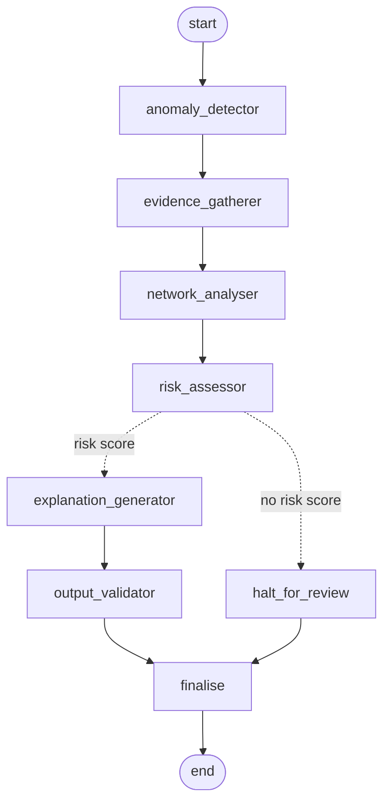

# FILE: docs/09_BACKEND/LANGGRAPH_PIPELINE.md

# LangGraph Investigation Pipeline

## Status

IMPLEMENTED (Phase 12). Code: `src/agents/pipeline_graph.py`
(`build_investigation_graph`), run by `src/agents/investigation.Investigator`.
Graph version `1.0.0` (`PIPELINE_VERSION`).

## Purpose

Coordinate the investigation workflow.

## Nodes

1. Anomaly Detector
2. Evidence Gatherer
3. Network Analyser
4. Risk Assessor
5. Explanation Generator
6. Output Validator

## Sequence

Anomaly Detector
→ Evidence Gatherer
→ Network Analyser
→ Risk Assessor
→ Explanation Generator
→ Output Validator

## State

The case state must carry the information required by downstream stages.

## Requirements

- structured handoffs
- error handling
- state preservation
- deterministic progression
- clear failure behavior

## Final State

A completed case should contain the investigation results, validation outcome, and information required by the dashboard and audit trail.

## Case entry point and label firewall (Phase 9.5)

`src/agents/sentinel_pipeline.new_case_state(transaction)` is the only
supported entry point. It assigns `case_id` / `case_created_at_utc` and strips
dataset ground truth (`is_fraud`, `metadata.risk_label`,
`metadata.scenario_id`) so no agent — and no LLM prompt built from agent
outputs — can see labels. `metadata.alert_id` and `is_flagged_fraud` are kept
(they describe the monitoring alert).

`Investigator.investigate(tx)` calls `new_case_state` and then invokes the
compiled graph. The graph is compiled once per `Investigator` and reused
across cases. `generate_report=False` builds the graph without the report
path (bulk evaluation).

## Graph

With `generate_report=False`, `risk_assessor` goes straight to `finalise`
when there is a risk score.

## Handoff rules (enforced by every agent node)

| Node | May write |
|---|---|
| `anomaly_detector` | `agent1_output` |
| `evidence_gatherer` | `agent2_output` |
| `network_analyser` | `agent3_output` |
| `risk_assessor` | `agent4_output` |
| `explanation_generator` | `agent5_output` |
| `output_validator` | `validation_output`, `agent5_output` (may present a validated template report), `rejected_reports` |

- A node receives a copy of the state. Any other field it returns is
  discarded, so no agent can change the transaction, the case id or another
  agent's output.
- Each written field must be an instance of the agent's output schema
  (`Agent1Output` … `ValidationOutput`). Otherwise the node is a handoff
  error and the value is not stored.
- Every node appends a `NodeRecord` to `pipeline_trace`: node, outcome
  (`OK` / `ERROR`), the agent's own status, start time, duration, and the
  error. The error is an exception type or a handoff problem, never an
  exception message, so nothing sensitive reaches the audit trail.

## Failure behaviour

| Situation | Behaviour | `pipeline_status` |
|---|---|---|
| All nodes ran | Normal completion. Agents' own statuses (PARTIAL, UNAVAILABLE …) are not node errors. | `COMPLETE` |
| A node raised or broke the handoff rules | The node's output is absent. The graph continues: Agent 4 scores the missing signal as unavailable, as documented. The validator's STRUCTURE check fails a report when an upstream output is missing, so the case goes to human review. | `DEGRADED` |
| Agent 4 produced no risk score (no output, `FAILED`, `VALIDATION_ERROR`) | `halt_for_review`: no report is generated; `halt_reason` is set. Agent 4's fail-safe `HUMAN_REVIEW` decision, if present, stands. | `HALTED` |
| Agent 5 raised | The validator runs on the missing report: `NEEDS_HUMAN_REVIEW`. | `DEGRADED` |
| The validator raised | The report keeps `validation_status = NOT_VALIDATED`; there is no `validation_output`. | `DEGRADED` |

The report path cannot bypass validation. The only edge out of
`explanation_generator` leads to `output_validator`, and
`build_investigation_graph` refuses an Agent 5 without a validation stage.

## Equivalence with the sequential runner (2026-11-22)

72 synthetic cases (6 per scenario, template reports, AuraDB). The first
measurement used fixture evidence by mistake; it was repeated with India
evidence on 2026-11-22 with the same result (0 mismatches). Agent 4
action, score, SAR recommendation and validation status were identical to the
previous sequential runner. All 72 were `COMPLETE` and `VALIDATED`. Graph
overhead is a few milliseconds per case.

## Observability

LangGraph installs `langsmith`. Tracing stays off unless
`LANGSMITH_TRACING=true`. Do not enable it: it would send case data to an
external service. The audit record is `pipeline_trace`.

## Not in this phase

- Checkpointing and persistence: the case store is Phase 13.
- LLM repair of a failed report: backlog item, needs a paid LLM tier.

## State fields

| Field | Written by |
|---|---|
| `case_id`, `case_created_at_utc`, `transaction` | `new_case_state` |
| `agent1_output` … `agent4_output` | Agents 1–4 |
| `agent5_output` | Agent 5, then `validation_status` set by the Output Validator; may be replaced by a validated template report |
| `validation_output` | Output Validator result for the presented report |
| `rejected_reports` | Reports that failed validation and were not presented, with their validation (audit) |
| `pipeline_trace` | Every node (one `NodeRecord` each; LangGraph append reducer) |
| `halt_reason` | `halt_for_review` |
| `pipeline_status`, `pipeline_version`, `case_completed_at_utc` | `finalise` |
